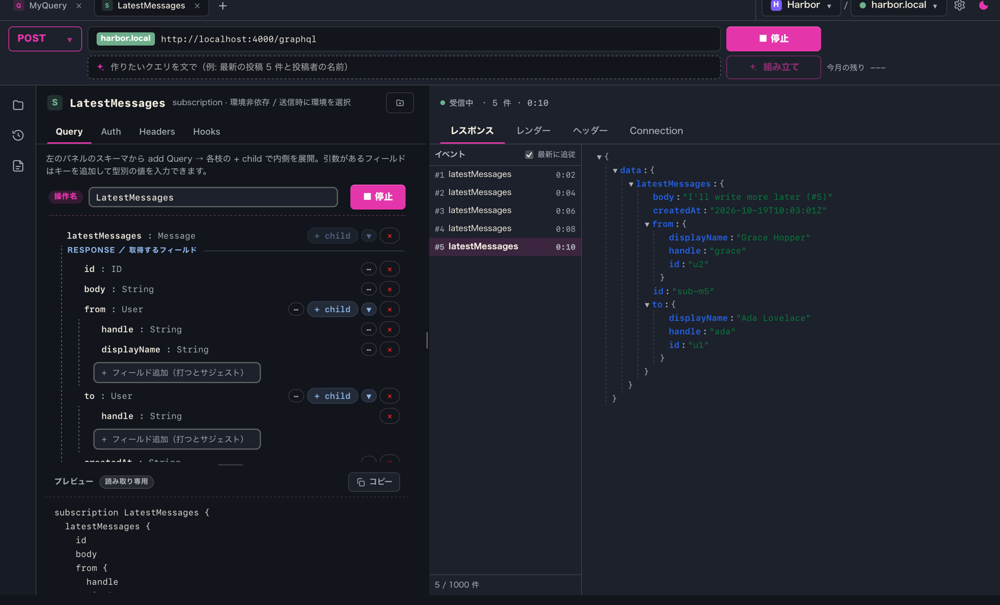
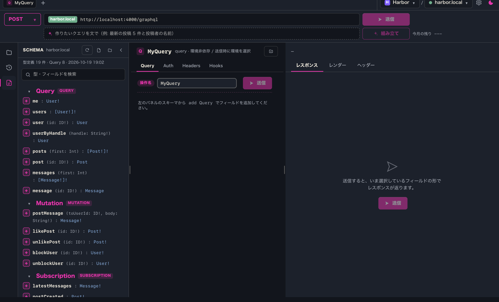
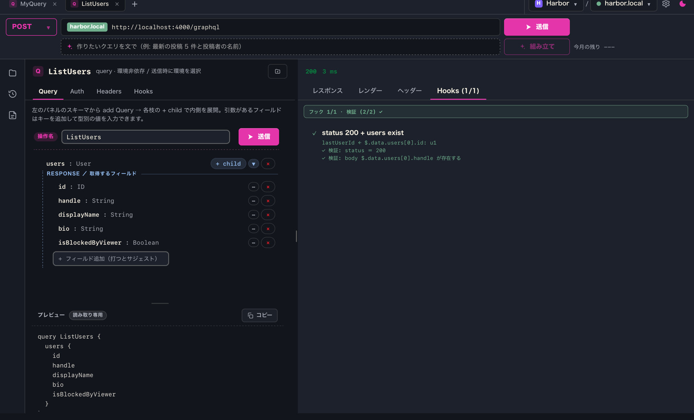

[English](./README.md) | **日本語**

# GalleonQL

  

GalleonQL は GraphQL 専用の API クライアントです。使うエンドポイントからスキーマを取り込み、そのスキーマをドキュメントとして読みながら `+` を押してクエリを組み立て、選んでいる環境へ送信するまでを 1 つのウィンドウで行えます。

このリポジトリは GalleonQL の**公開課題トラッカー**です。バグ報告や機能要望はこちらで受け付けます。GalleonQL 本体はクローズドソースです。

- **ダウンロード**: macOS は [Mac App Store](https://apps.apple.com/jp/app/id6814500019)（macOS 13 以降）、Windows・Linux は [Releases](https://github.com/trimixjp/GalleonQL/releases)

詳しくは[公式ウェブサイト](https://galleonql.com/)をご覧ください。

  
  

## 報告のしかた

新しい Issue を作成し、テンプレートを選んでください。

- **Bug report** — 期待どおりに動作しないとき。
- **Feature request** — 改善や新機能の提案。
- **Language request** — 新しい UI 言語のリクエスト。

どのテンプレートでも日本語での報告を歓迎します。書きやすい言語でお書きください。

## 修正の進め方

公開トラッカーで受け付けたバグや要望は、修正されましたらリリースノートで告知します。

## 対応言語

現在は日本語と英語のみです。\
他の言語は要望と寄付に応じて追加します。

言語をリクエストするには **Language request** の Issue を作成してください。
