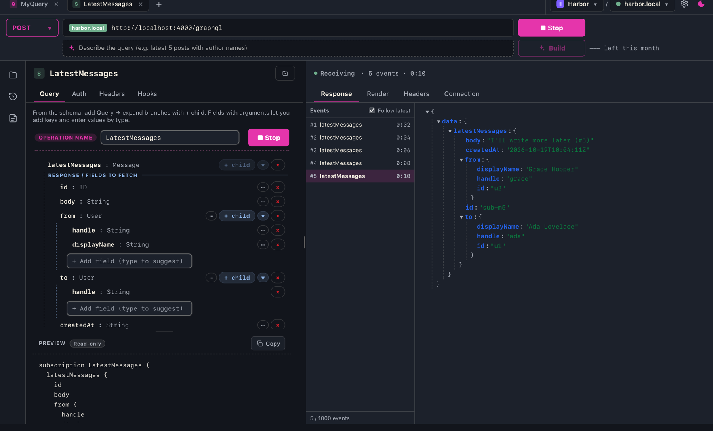
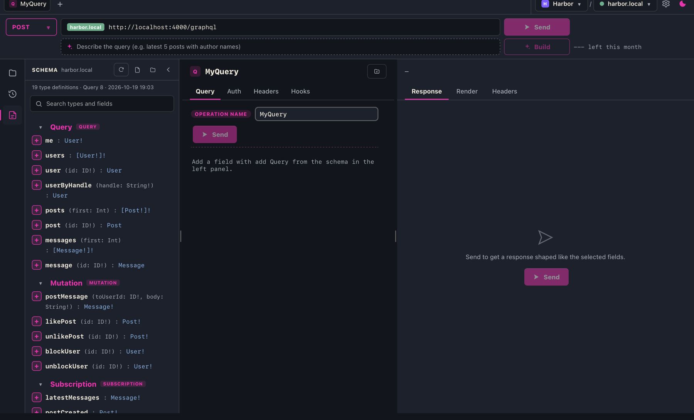
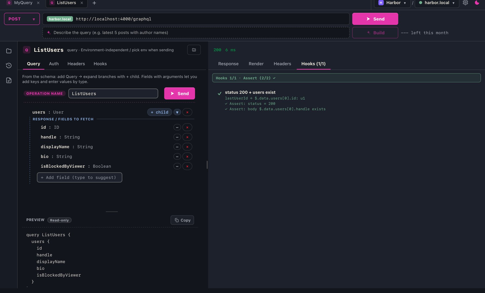

**English** | [日本語](./README-ja.md)

# GalleonQL

  

GalleonQL is an API client built specifically for GraphQL. Import the schema from the endpoint you work with, build a query by pressing `+` while you read that schema as documentation, and send it to whichever environment is selected, all in one window.

This repository is the **public issue tracker** for GalleonQL — report bugs and request features here. GalleonQL itself is closed-source.

- **Download**: macOS — [Mac App Store](https://apps.apple.com/us/app/id6814500019) (macOS 13 or later) / Windows and Linux — [Releases](https://github.com/trimixjp/GalleonQL/releases)

For details, see the [official website](https://galleonql.com/).

  
  

## How to report

Open a new issue and pick a template:

- **Bug report** — something isn't working as expected.
- **Feature request** — suggest an improvement or new capability.
- **Language request** — ask for a new UI language.

Japanese is welcome in every template — write in whichever language is easier for you.

## How fixes are handled

Bugs and requests received in this public tracker are announced in the release notes once they are fixed.

## Languages

GalleonQL is currently available in Japanese and English only.\
Other languages are added based on requests and donations.

To request a language, open a **Language request** issue.
